# CuiSharp

**Native desktop UI in plain C#.** No XAML, no WPF, no Avalonia, no web view.

CuiSharp binds [CUI](https://github.com/yappologistic/CUI), a 160-component UI library written in C99 that draws
every widget itself. You describe the screen again each frame; your fields are the state.


[](LICENSE)

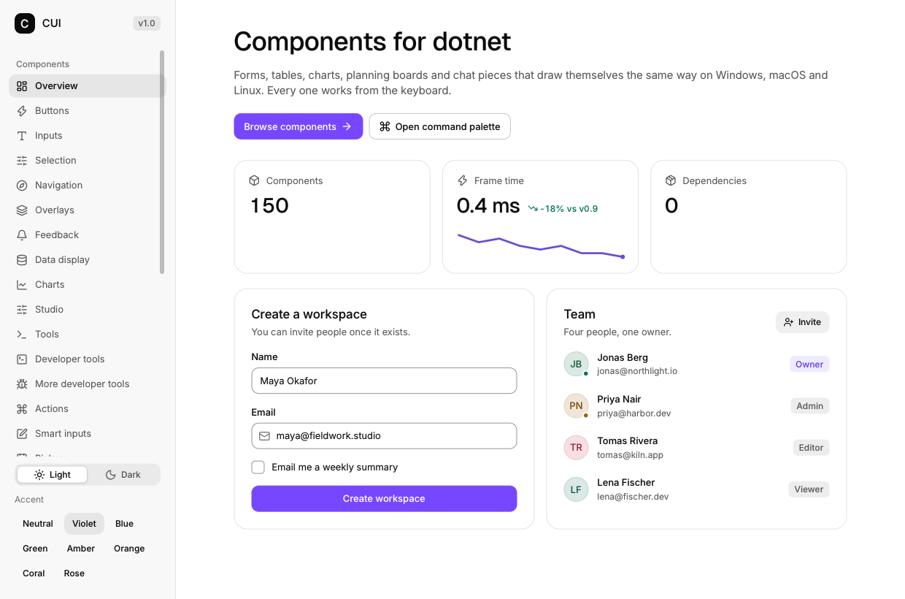

```sh
dotnet new install CuiSharp.Templates
dotnet new cui-app -n MyApp && cd MyApp
dotnet watch run --project MyApp
```

What you get: a two-page app — todos, and a simulated 50 Hz market feed with a sparkline per row
and a decimated chart — with a light/dark switch, a footer that reports the frame's own draw time,
interval, frame rate and allocations, a test project that clicks through real frames, and an
`AGENTS.md` for whoever edits it next.

Also `dotnet add package CuiSharp` for an existing project. Requires the .NET 10 SDK.

## The one idea

A frame is a pure function of your fields. No control tree, no binding, no invalidation:
conditional UI is an `if`, a list is a `for`.

```csharp
using CuiSharp;

int clicks = 0;
return CuiApp.Run(new CuiAppOptions { Title = "Hello", Width = 420, Height = 300 }, ui =>
{
    using (ui.Column(new Box { Pad = 32, Gap = 16 }))
    {
        ui.Heading("Hello, CUI", 2);
        if (ui.Button("Click me", new ButtonOpts { Variant = ButtonVariant.Primary })) clicks++;
        ui.Text($"Clicked {clicks} times");
    }
});
```

`Ui` and every container scope are `ref struct`: the compiler rejects storing them, capturing them,
or holding them across an `await`. Nothing can outlive the frame, so nothing can go stale.

## Why it is fast, and stays fast

| | |
|---|---|
| **One executable** | NativeAOT links CUI in statically: no runtime, no `cui.dll`, no VC++ redistributable. The gallery is 2.0 MB. |
| **No UI framework** | CUI creates the window, owns the message loop and the GL context. `CuiApp.Run` is the entire host. |
| **Sub-millisecond frames** | 0.85 ms mean for the live gallery, software rasterizer, 1240×820 (`--fps 900`). |
| **0 B per frame** | Labels, options and interpolated text come from a per-frame arena. A live chart with a million samples allocates nothing. |
| **Idle costs nothing** | The window sleeps until an input event, a mutation, or a `WantsFrames` page asks for a frame. |
| **A million rows** | Lists virtualize (~12 µs); charts decimate long feeds for free (`ChartOpts.MaxPoints`). |
| **Hot reload** | The frame loop is managed, so `dotnet watch` patches your UI between frames. |

Numbers, method and caveats: [docs/PERFORMANCE.md](docs/PERFORMANCE.md).

## What it looks like

Eleven pages of the gallery, drawn by the app itself, in light and dark
([all snapshots](docs/images/gallery), regenerated by `pwsh tools/snapshots.ps1`):

| | | |
|---|---|---|
| [](docs/images/gallery/01-overview.png) **Overview** | [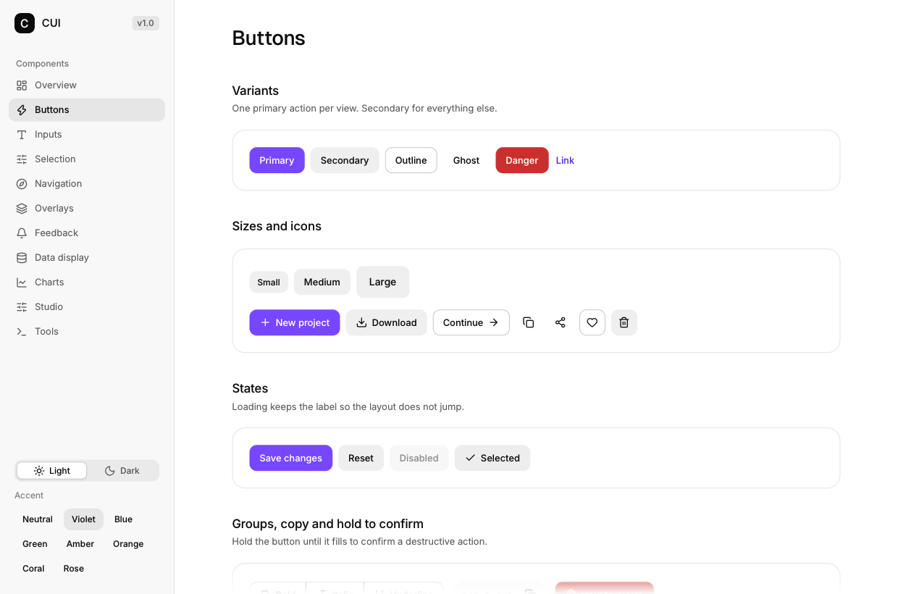](docs/images/gallery/02-buttons.png) **Buttons** | [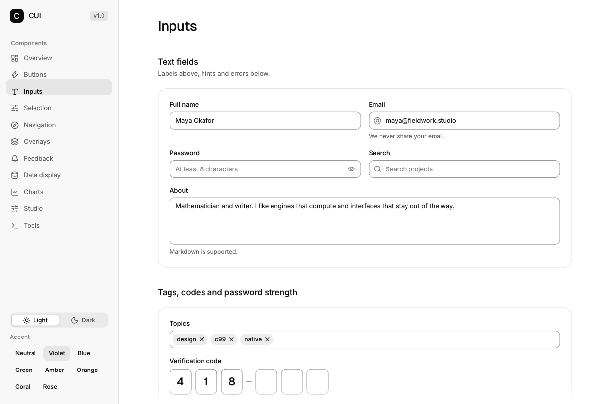](docs/images/gallery/03-inputs.png) **Inputs** |
| [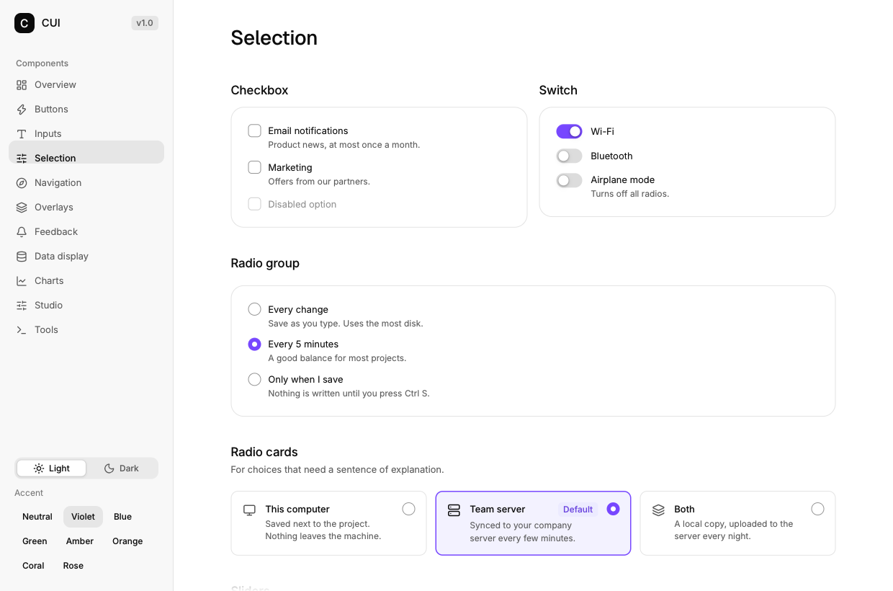](docs/images/gallery/04-selection.png) **Selection** | [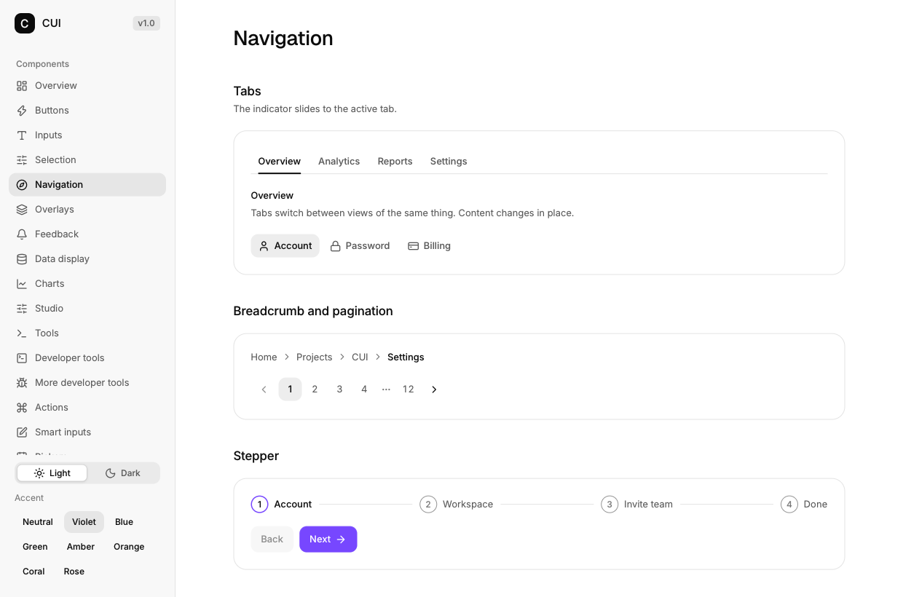](docs/images/gallery/05-navigation.png) **Navigation** | [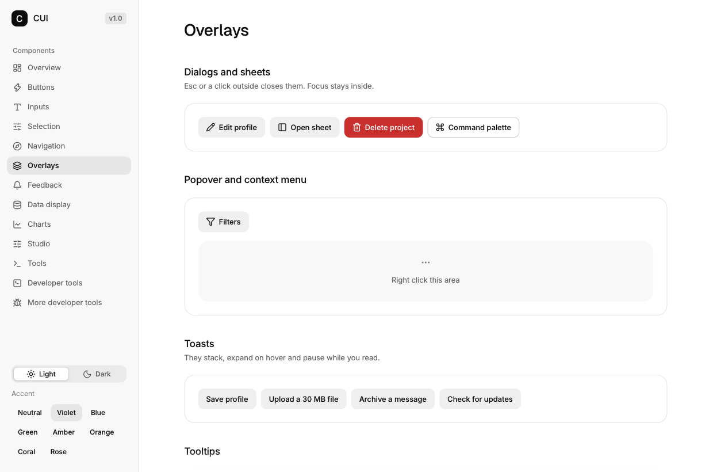](docs/images/gallery/06-overlays.png) **Overlays** |
| [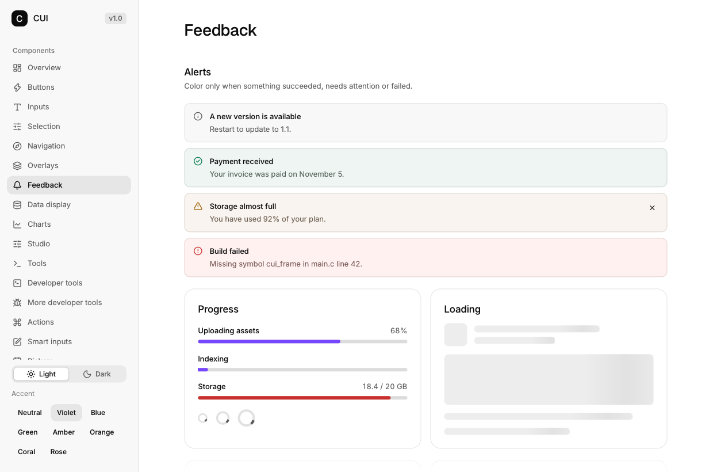](docs/images/gallery/07-feedback.png) **Feedback** | [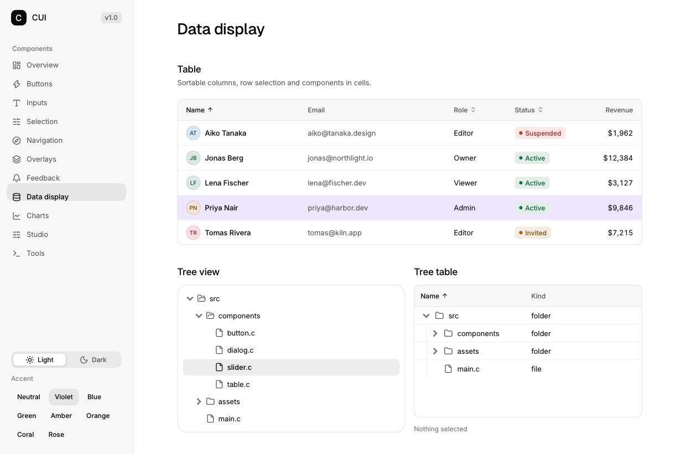](docs/images/gallery/08-data.png) **Data display** | [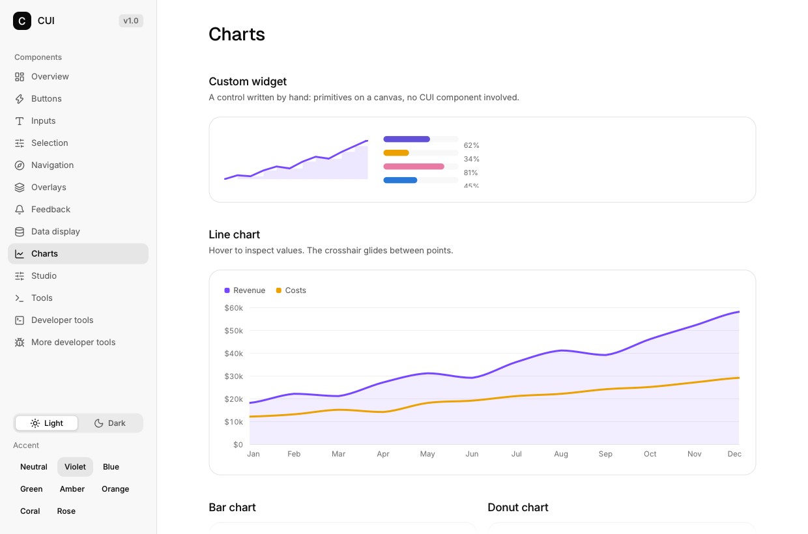](docs/images/gallery/09-charts.png) **Charts** |
| [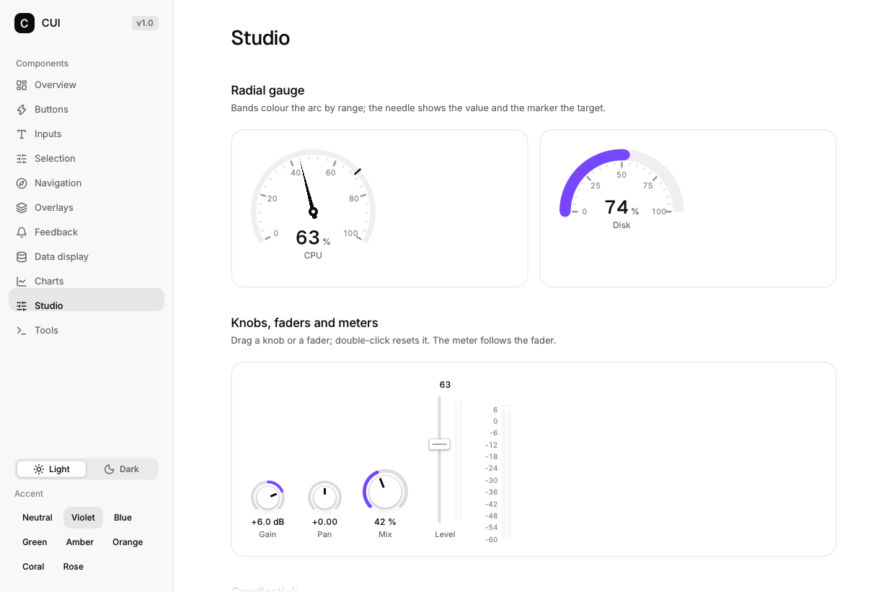](docs/images/gallery/10-studio.png) **Studio** | [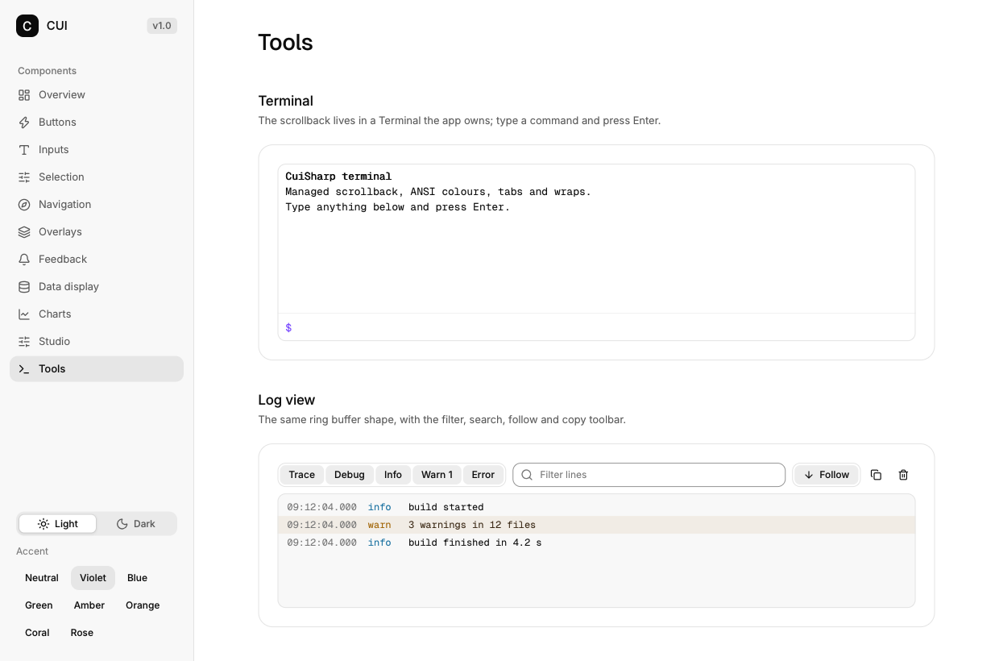](docs/images/gallery/11-tools.png) **Tools** | [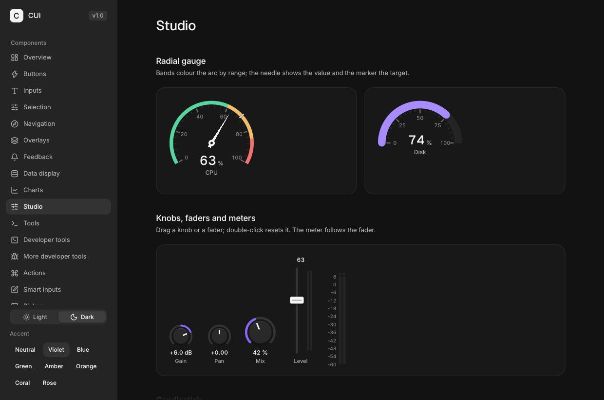](docs/images/gallery/10-studio-dark.png) **Dark** |

## Writing UI

```csharp
using (ui.Column(new Box { Pad = 16, Gap = 8 }))          // stacks children
using (ui.Row(new Box { Gap = 8 }))                       // side by side
using (ui.Card(new() { Id = "editor", Width = Size.Fill }))
using var dialog = ui.Dialog("confirm", ref open);        // opens only when open
{
    ui.Input("draft", ref draft, new InputOpts { AutoFocus = true });
    ui.Select("tone", Tones, ref tone);                   // interactive widgets take ref
    ui.Checkbox("Pinned", ref pinned);
    if (ui.Button("Save")) Save();
}
```

- **Text is one type.** `ui.Text("Saved")`, `ui.Text("Saved"u8)` and `ui.Text($"Clicked {n,6:D3}")`
  are one method; interpolation formats straight into the frame arena.
- **Options are structs of public fields**, one per component, defaulted to CUI's defaults.
- **Ids are stable strings**; `ui.Keyed(items, key)` gives a list rows ids that survive reordering.
- **Theme colours** come from `Color.Accent`, `ui.ColorOf(color)`, `ui.TokenColor(token)`, so light
  and dark work without a second palette.

A component is a class with fields and a `Draw(Ui)` method. Composition is a `using` block, a
`foreach`, or `ui.Component(child)`:

```csharp
sealed class TodoPage : Component
{
    private readonly List<Todo> _todos = [];
    private readonly Mutation<Todo> _add;

    public TodoPage(TodoService service) => _add = new Mutation<Todo>(service.AddAsync, Add);

    protected override void Draw(Ui ui)
    {
        using var card = ui.Card(new() { Id = "todos", Pad = 16, Gap = 12 });
        ui.Heading("Todos", 2);
        foreach (Todo todo in _todos) ui.Checkbox(todo.Title, ref todo.Done);
        if (ui.Button("Add", new ButtonOpts { Variant = ButtonVariant.Primary, Disabled = _add.IsRunning }))
            _add.Run(new Todo("Untitled"));
        if (_add.Error is { } error) ui.Alert(error.Message, new AlertOpts { Tone = Tone.Danger });
    }

    private void Add(Todo todo) => _todos.Add(todo);
}
```

Async work never runs in a frame: `Mutation` publishes its result at the next frame boundary, and
`WantsFrames` keeps the loop awake while something is outstanding.

**Custom controls** are `static` extension blocks, indistinguishable from built-in widgets at the
call site — no base class, no registration, no allocation:

```csharp
internal static class MyControls
{
    extension(Ui ui)
    {
        public void Spark(float[] values) =>
            ui.Canvas("spark", Size.Fill, Size.Px(60), (paint, box) =>
            {
                for (int i = 1; i < values.Length; i++)
                    paint.DrawLine(box.X + i - 1, box.Y + values[i - 1], box.X + i, box.Y + values[i],
                                   1.5f, Color.Accent);
            });
    }
}

ui.Spark(Monthly.Revenue);
```

## Test it, and let an agent drive it

`CuiSharp.Testing` runs the real component with no window: find a control by what it says, click it,
type into it, assert on the model or on the pixels.

```csharp
using var app = TestApp.Start(new TodoPage(service), 800, 600);
app.FindButton("Add").Click();
app.Type("Milk");
Assert.Equal("Milk", page.Draft);
Assert.Empty(app.Faults);
Assert.True(app.PaintedAnything());
```

`dotnet cui` does the same thing to a real app process from a shell, with nothing added to the app:

```sh
dotnet cui tree                  # the controls of the last frame, nested
dotnet cui click Save            # click a control, print the frame it produced
dotnet cui click Button "Save"   # …when a heading says the same word
dotnet cui click editor > Save   # …or name the path to the control
dotnet cui type Milk             # type into the focused field
dotnet cui png shot.png          # the frame as a PNG, for a person or a model
```

```
Frame
  Card "editor"
    Heading "Note"
    Input "draft"
    Button "Save"
```

The app serves this itself (`CUISHARP_HEADLESS=1`), so what a tool sees is what a user sees — no
debug mode, no mock, no second code path. For a check that has to hold, prefer
`CuiSharp.Testing`: frames on demand, milliseconds, and the reproduction stays in the suite.

**Analyzers ship in the package** and turn the six mistakes that cost the most into build errors or
warnings: a blocking call in a frame (`CUI001`), a container scope without `using` (`CUI002`), a
popover body that never checks `Open` (`CUI003`), a constant id in a loop (`CUI004`),
`ConfigureAwait(false)` or `async void` in a component (`CUI005`, `CUI006`), and an allocation in a
frame (`CUI007`). Each message says what to do instead.

## Install and publish

```sh
dotnet add package CuiSharp              # library + analyzers + cui.dll/cui.lib
dotnet add package CuiSharp.Testing      # tests only
dotnet tool install -g CuiSharp.Tools    # the `cui` command
```

```xml
<!-- one line in your app's csproj; a template app already has it -->
<PropertyGroup Condition="'$(RuntimeIdentifier)' != ''">
  <PublishAot>true</PublishAot>
</PropertyGroup>
```

```sh
dotnet publish -c Release -r win-x64      # one executable, ~2 MB, nothing beside it
```

`cui.lib` is linked statically through the package's targets, so there is no `cui.dll` in the output.
NativeAOT does not cross-compile between operating systems: publish on the platform you target
(`libx11-dev` is needed at build time on Linux, not at run time).

The package ships `win-x64`, `linux-x64` and `osx-arm64`. The Linux archive needs **glibc 2.35 or
newer** (Ubuntu 22.04, Debian 12, RHEL 9); an older image fails at load with
`version 'GLIBC_x.y' not found`, which `CuiSharpNativeException` restates with the packaged RIDs
and the floor. `runtimes/native-provenance.txt` in the package records the revision, compiler and
per-file hashes behind it; [docs/NATIVE-ABI.md](docs/NATIVE-ABI.md) is the promise itself.

## Gallery and layout

```sh
git clone --recurse-submodules <this repo> && cd CuiSharp
pwsh native/build-native.ps1     # or ./native/build-native.sh
dotnet run --project samples/CuiSharp.Gallery
```

```
src/CuiSharp/            the library: Interop (generated), Ui, Runtime, Semantics, Hosting, Charting
src/CuiSharp.Analyzers/  CUI001-CUI007, packed into CuiSharp
src/CuiSharp.Testing/    TestApp: drive a component without a window
src/CuiSharp.Tools/      dotnet cui
src/CuiSharp.Templates/  dotnet new cui-app
samples/CuiSharp.Gallery/ eleven pages, one file per page
native/                  the CUI submodule and the two build scripts
tools/                   bindgen.cs, regen.ps1, verify-template.ps1, snapshots.ps1
bindings/                api.json (generated), overrides.json (inputs), coverage.txt (report)
docs/                    PLAN (remaining work), ARCHITECTURE (rules), PERFORMANCE, HOSTING,
                         RELEASING, NATIVE-ABI, API-SURFACE.txt, images/gallery/
skills/cui-dotnet/       the bundle: the guide, the reference, the API pages, the widget docs
```

## Where to read

Everything someone needs to build an app ships in one folder — `skills/cui-dotnet/` — and the NuGet
package carries it at that same path, so a link works whether you are reading the repository or the
package you just installed:

| | In this repository | In the package |
|---|---|---|
| Start here: how to write a UI, the pitfalls, the workflow | [SKILL.md](skills/cui-dotnet/SKILL.md) | `skills/cui-dotnet/SKILL.md` |
| Every widget and signature, one line each | [llms.txt](skills/cui-dotnet/llms.txt) | `skills/cui-dotnet/llms.txt` |
| Options and records, per section | [api/](skills/cui-dotnet/api) | `skills/cui-dotnet/api/` |
| What each component does, and its keyboard | [widgets.md](skills/cui-dotnet/widgets.md), [widgets-more.md](skills/cui-dotnet/widgets-more.md) | same |
| Components, `Mutation<T>`, dependency injection | [hosting.md](skills/cui-dotnet/hosting.md) | `skills/cui-dotnet/hosting.md` |
| RIDs carried, glibc floor, provenance | [native-abi.md](skills/cui-dotnet/native-abi.md) | `skills/cui-dotnet/native-abi.md` |

An assistant needs the first two: point it at the folder and say "read `SKILL.md`". What produces
each file — and which ones are copies that must not be edited — is
[the bundle's README](skills/cui-dotnet/README.md).

## Contributing

```sh
dotnet build CuiSharp.slnx -c Release -warnaserror
dotnet test  CuiSharp.slnx -c Release
pwsh tools/regen.ps1 -NoNative -NoDiff     # generated output is up to date
```

`src/CuiSharp/Interop/*.g.cs`, `src/CuiSharp/Ui/*.g.cs`, `Icons.g.cs`, the generated ABI and option
tests, the bundle's `llms.txt` and `api/*.md`, and `bindings/{api.json,coverage.txt}` come from the
CUI headers; the bundle's `widgets*.md`, `hosting.md` and `native-abi.md` are copies of pages kept
elsewhere.
Never edit them: change `tools/bindgen.cs` or `bindings/overrides.json`, then regenerate. Syncing a
CUI release is checking out the new tag, running `regen.ps1`, and reviewing the `api.json` diff.

Rules and decisions: [docs/ARCHITECTURE.md](docs/ARCHITECTURE.md). Remaining work:
[docs/PLAN.md](docs/PLAN.md). Authoring guide: the bundle below.

## Status

Pre-1.0: the API may still change. The binding covers every CUI function (356 generated wrappers,
156 deliberate hand-written ones, 4 excluded with a written reason, 0 pending — see
[bindings/coverage.txt](bindings/coverage.txt)). The nine core gallery pages are ported; the
thirteen extended upstream pages are not yet.

## License

MIT. CUI is MIT. Icons are Lucide (ISC). Fonts are Inter and Geist (OFL 1.1).
