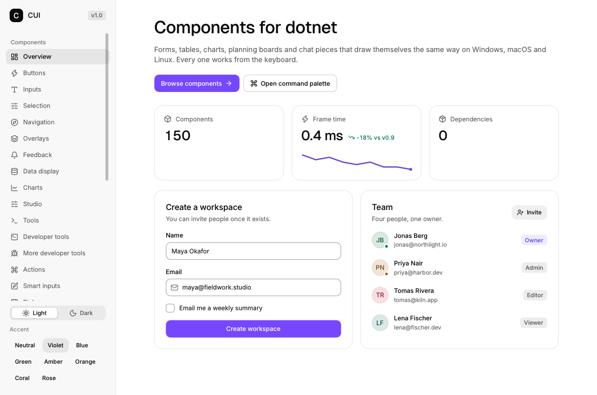

# CuiSharp.Gallery

Every component the binding wraps, in eleven pages, one file per page. It is the integration test
and the size/performance canary at the same time: it uses no hosting, no DI and no test project, so
it measures the library a person gets.



```sh
dotnet run                              # JIT, loads the CUI shared library
dotnet watch                            # the same, with hot reload on the page files
dotnet run -- --page=8                  # open one page directly
dotnet publish -c Release -r win-x64     # one self-contained executable
```

Environment and arguments:

| Setting | Effect |
|---|---|
| `--page=N` | start on page N (0-based, in sidebar order) |
| `CUI_THEME=dark` | start in dark mode (Ctrl+J toggles at runtime) |
| `CUI_SCREENSHOT=shot.png` | CUI draws N frames, writes a PNG and exits |
| `CUI_SCREENSHOT_FRAMES=8` | how many frames before that PNG |

## Driving it without a window

Any CuiSharp app serves the headless protocol when it is asked to, so the gallery needs no debug
mode — `dotnet cui` builds it, runs it and talks to it:

```sh
dotnet cui tree                     # every control the last frame drew, nested
dotnet cui click NavItem "Charts"   # navigate, and print the page the click opened
dotnet cui frame 6                  # let an animation settle
dotnet cui png docs/images/gallery/09-charts.png
```

The screenshots in `../docs/images/gallery` come from exactly that; `pwsh tools/snapshots.ps1`
regenerates all of them (and `-Theme dark` the dark set).

## Files

| File | Contents |
|---|---|
| `Program.cs` | the host: `CuiApp.Run` plus the `--page` argument |
| `GalleryApp.cs` | state, page list, static data |
| `GalleryApp.Shell.cs` | frame loop, sidebar, navigation, command palette, dialogs |
| `Pages/*.cs` | one page each |
| `Pages/CustomControls.cs` | hand-written controls as `extension(Ui ui)` members |

## What is ported

All nine pages of CUI's `examples/gallery_ui.c` — Overview, Buttons, Inputs, Selection, Navigation,
Overlays, Feedback, Data display, Charts — plus two pages written for this binding: **Studio**
(gauges, knobs, faders, meters) and **Tools** (terminal, log view, hex view, diff).

The thirteen extended pages of `examples/gallery_more.c` are **not** ported yet; it is the first
item in its [changelog](../../CHANGELOG.md).

## A page

A page is a method that draws into the `Ui` it is given. State lives in `GalleryApp` fields, and
nothing subscribes to anything:

```csharp
private void PageCharts(Ui ui)
{
    Section(ui, "Line chart", "Hover to inspect values.");
    using (ui.Card(new Card()))
        ui.LineChart("revenue", _lineSeries, new ChartOpts { Height = 240 });
}
```
